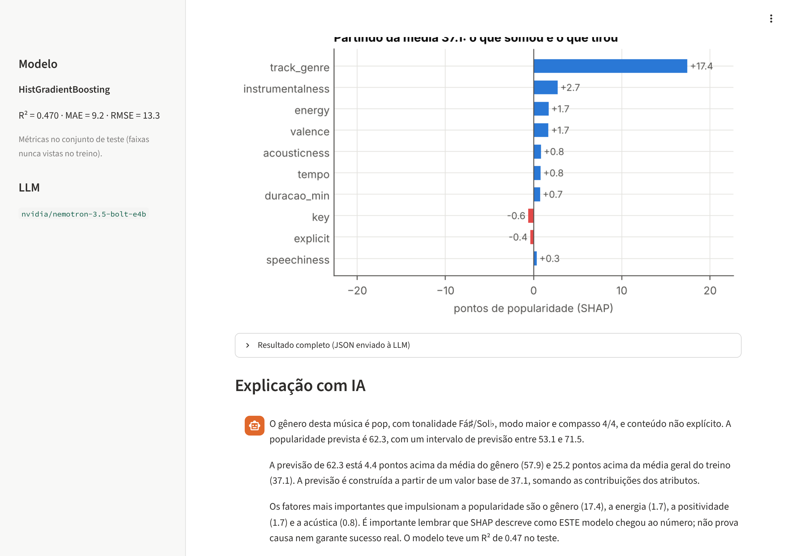
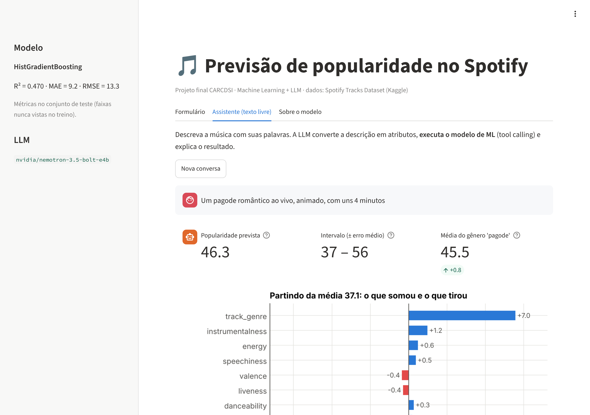

# Previsão de popularidade no Spotify com ML + LLM

**[Português](#português) · [English](#english)**

Projeto final da disciplina **CARCDSI** (IFSP). Sistema que estima a
popularidade (0–100) de uma música do Spotify a partir das características de
áudio e do gênero, explica cada previsão com **SHAP** e usa uma **LLM** (NVIDIA,
via SDK da OpenAI) para comunicar o resultado e para transformar uma descrição
em texto livre em uma previsão (*tool calling*).

| Aluno | Prontuário |
|---|---|
| Arthur de Morais Marques | CG3033856 |
| Vinícius Francisco Garcia Sobral | CG3034241 |

---

## Português

### Visão geral

```
dataset.csv ─► preparar.py ─► explorar.py ─► treinar.py ─► prever.py ─► processar.py / app.py
 (Kaggle)       limpeza        gráficos EDA   5 modelos +    ficha.json →   LLM explica e
                                              CV agrupada    previsão+SHAP  conversa
```

| Script | O que faz | Gera |
|---|---|---|
| `preparar.py` | limpeza: duplicatas, valores inválidos, agrupamento de versões da mesma música, marcação da popularidade zero | `dados/processado/spotify_limpo.csv`, `resultados/preparacao.json` |
| `explorar.py` | análise exploratória | `resultados/figuras/01..05_*.png`, `resultados/eda.json` |
| `treinar.py` | Dummy, média do gênero, Ridge, Random Forest e HistGradientBoosting; ajuste por validação cruzada agrupada (5 folds); métricas; importância por permutação; experimentos | `modelos/modelo.joblib`, `resultados/metricas.json`, `resultados/figuras/06..09_*.png` |
| `prever.py` | lê `ficha.json`, valida, prevê e explica com SHAP | `resultado.json` |
| `processar.py` | LLM: relato, chat e assistente com *tool calling* | — |
| `app.py` | interface Streamlit para demonstração | — |
| `verificar.py` | confere instalação, dados, modelo, previsão e (com `--llm`) a chave | — |
| `avaliar_llm.py` | mede se a LLM cita só números que existem no resultado | `resultados/avaliacao_llm.json` |
| `config.py` | caminhos, colunas e semente compartilhados | — |

Decisões de metodologia (com justificativa e números) estão em
[`docs/decisoes.md`](docs/decisoes.md); a descrição de cada coluna, original
ou criada, está em [`docs/dicionario_dados.md`](docs/dicionario_dados.md).

### Resultados

Conjunto de teste: **16.095 faixas** (20%) de músicas que não aparecem no
treino (nem em outra versão, nem com áudio idêntico sob outro título).
Hiperparâmetros escolhidos por validação cruzada agrupada (5 folds).

| Modelo | RMSE (val. cruzada) | MAE | MSE | RMSE | R² |
|---|---:|---:|---:|---:|---:|
| Dummy (sempre a média) | 18,13 | 15,21 | 332,3 | 18,23 | 0,000 |
| Média do gênero | 13,60 | 9,82 | 188,7 | 13,74 | 0,432 |
| Ridge (α = 1) | 13,52 | 9,76 | 186,6 | 13,66 | 0,439 |
| Random Forest | 13,98 | 10,41 | 198,2 | 14,08 | 0,404 |
| **HistGradientBoosting** | **13,18** | **9,24** | **176,0** | **13,27** | **0,470** |

- O **HistGradientBoosting** foi o melhor: erra em média **9,2 pontos** de
  popularidade (o Dummy erra 15,2). Em 5 divisões diferentes, R² = 0,471 ± 0,005.
- **O gênero domina.** Sozinho, ele já explica R² = 0,43; os atributos de áudio
  acrescentam cerca de 0,04. Na importância por permutação, embaralhar o
  gênero aumenta o RMSE em 6,9 pontos; o segundo atributo (`instrumentalness`)
  aumenta só 0,4.
- **O modelo puxa as previsões para a média:** superestima faixas pouco
  populares (+11,4 pontos na faixa 1–20) e subestima hits (−33,4 na faixa
  81–100). Ele não serve para "descobrir hits".
- **Experimentos** (mesmos hiperparâmetros, 5 divisões cada): incluir a
  popularidade zero derruba o R² para 0,350; a divisão aleatória o infla em
  +0,016 (em 5 de 5 divisões), por vazamento entre versões da mesma música;
  testar só com artistas que não estão no treino reduz o R² em 0,018. Refazer
  o sorteio do gênero não muda os resultados.
- **Fidelidade da LLM:** em 90 explicações geradas para cinco músicas
  (`avaliar_llm.py`), nenhuma citou número que não estivesse no resultado do
  modelo. Erros vistos durante o desenvolvimento ("47,4 é inferior a 46,7",
  tonalidade errada, LaTeX no texto) eram intermitentes e foram tratados por
  construção: comparações e nomes são calculados pelo programa, não pela LLM.

A popularidade depende de fatores que não estão nos dados (artista, marketing,
playlists, data de lançamento); um R² moderado é um limite do problema, não
uma falha do modelo. Detalhes e justificativas em
[`docs/decisoes.md`](docs/decisoes.md).

| Formulário + SHAP + explicação da LLM | Assistente com *tool calling* |
|---|---|
|  |  |

Figuras da análise e dos modelos: [`resultados/figuras/`](resultados/figuras/).

### Como executar

Requisitos: **Python 3.14** e uma chave da NVIDIA (build.nvidia.com) para a parte
de LLM. O dataset original já está em `dados/bruto/dataset.csv`.

**Windows (PowerShell)** — execute uma linha por vez, na pasta do projeto:

```powershell
py -3.14 -m venv .venv
.\.venv\Scripts\python.exe -m pip install -r requirements.txt
.\.venv\Scripts\python.exe preparar.py
.\.venv\Scripts\python.exe explorar.py
.\.venv\Scripts\python.exe treinar.py
.\.venv\Scripts\python.exe prever.py
$env:NVIDIA_API_KEY = "nvapi-..."
.\.venv\Scripts\python.exe verificar.py --llm
.\.venv\Scripts\python.exe processar.py --modo relato
.\.venv\Scripts\python.exe -m streamlit run app.py
```

**Linux / macOS:**

```bash
python3.14 -m venv .venv
.venv/bin/python -m pip install -r requirements.txt
.venv/bin/python preparar.py
.venv/bin/python explorar.py
.venv/bin/python treinar.py
.venv/bin/python prever.py
export NVIDIA_API_KEY="nvapi-..."
.venv/bin/python verificar.py --llm
.venv/bin/python processar.py --modo relato
.venv/bin/python -m streamlit run app.py
```

Observações:

- `treinar.py` leva cerca de 20 minutos em 4 núcleos (busca de hiperparâmetros e experimentos). Para testar
  o código mais rápido: `treinar.py --rapido`. Para o experimento com a
  popularidade zero no modelo principal: `treinar.py --com-zeros`.
- `processar.py` tem três modos: `--modo relato` (explica `resultado.json`),
  `--modo chat` (relato + conversa) e `--modo assistente` (descreva a música
  em texto; a LLM chama o modelo de ML).
- Modelo de LLM padrão: `nvidia/nemotron-3.5-bolt-e4b`. Para trocar, defina
  `NVIDIA_MODEL` (ex.: `nvidia/nemotron-3.5-lightning-30b-a3b`). Para usar outro
  serviço compatível com a API da OpenAI, defina também `LLM_BASE_URL`.
- **Nunca** publique sua chave: ela fica só na variável de ambiente do terminal.

### Estrutura

```
├── config.py, preparar.py, explorar.py, treinar.py, prever.py, processar.py, app.py
├── verificar.py, avaliar_llm.py
├── ficha.json               # exemplo de entrada para prever.py
├── requirements.txt         # versões fixas
├── dados/
│   ├── bruto/dataset.csv    # original do Kaggle
│   ├── origem.json          # fonte e contagem de linhas
│   └── processado/          # gerado por preparar.py (não versionado)
├── modelos/                 # gerado por treinar.py (não versionado)
├── resultado.json           # saída de prever.py para ficha.json (exemplo)
├── resultados/              # métricas (JSON) e figuras
├── .streamlit/config.toml   # aparência da interface
└── docs/
    ├── decisoes.md          # decisões de metodologia
    ├── dicionario_dados.md  # colunas originais e criadas
    └── imagens/             # telas da interface
```

### Dados

Spotify Tracks Dataset, de Maharshi Pandya, disponível no
[Kaggle](https://www.kaggle.com/datasets/maharshipandya/-spotify-tracks-dataset)
e no [Hugging Face](https://huggingface.co/datasets/maharshipandya/spotify-tracks-dataset):
114.000 linhas, 114 gêneros (1.000 faixas cada), atributos de áudio da API do
Spotify, coletados em 2022. Licença indicada no cartão do Hugging Face: BSD.
O CSV original está incluído para facilitar a replicação, com crédito ao autor.
Dicionário completo: [`docs/dicionario_dados.md`](docs/dicionario_dados.md).

---

## English

### Overview

Final project for the **CARCDSI** course (IFSP). The system estimates the
popularity (0–100) of a Spotify track from its audio features and genre,
explains every prediction with **SHAP**, and uses an **LLM** (NVIDIA, through
the OpenAI SDK) to communicate the result and to turn a free-text description
into a prediction (*tool calling*).

| Script | Purpose |
|---|---|
| `preparar.py` | data cleaning (duplicates, invalid values, grouping versions of the same song, flagging zero popularity) |
| `explorar.py` | exploratory data analysis (figures in `resultados/figuras/`) |
| `treinar.py` | Dummy, genre-mean, Ridge, Random Forest and HistGradientBoosting; grouped 5-fold cross-validation; test metrics; permutation importance; extra experiments |
| `prever.py` | reads `ficha.json`, validates it, predicts and explains with SHAP → `resultado.json` |
| `processar.py` | LLM: report, chat and tool-calling assistant |
| `app.py` | Streamlit demo interface |
| `verificar.py` | checks installation, data, model, prediction and (with `--llm`) the API key |
| `avaliar_llm.py` | measures whether the LLM only cites numbers present in the model output |

Methodology decisions are documented (in Portuguese) in
[`docs/decisoes.md`](docs/decisoes.md).

### Results

Test set: **16,095 tracks** (20%) from songs never seen in training (not as
another version, nor as identical audio under another title).
Hyperparameters chosen by grouped 5-fold cross-validation.

| Model | RMSE (CV) | MAE | MSE | RMSE | R² |
|---|---:|---:|---:|---:|---:|
| Dummy (always the mean) | 18.13 | 15.21 | 332.3 | 18.23 | 0.000 |
| Genre mean | 13.60 | 9.82 | 188.7 | 13.74 | 0.432 |
| Ridge (α = 1) | 13.52 | 9.76 | 186.6 | 13.66 | 0.439 |
| Random Forest | 13.98 | 10.41 | 198.2 | 14.08 | 0.404 |
| **HistGradientBoosting** | **13.18** | **9.24** | **176.0** | **13.27** | **0.470** |

- HistGradientBoosting is the best model: mean absolute error of **9.2
  popularity points** (Dummy: 15.2); R² = 0.471 ± 0.005 over 5 splits.
- **Genre dominates:** on its own it explains R² = 0.43; audio features add
  about 0.04.
- The model **shrinks predictions toward the mean**: +11.4 points for tracks
  with popularity 1–20 and −33.4 for hits (81–100).
- Experiments (5 splits each): including zero-popularity tracks lowers R² to
  0.350; a random split inflates it by +0.016 (5 of 5 splits) through leakage
  between versions of the same song; unseen artists lower it by 0.018.
- **LLM faithfulness:** across 90 explanations for five songs
  (`avaliar_llm.py`), the LLM never cited a number absent from the model
  output. Intermittent errors seen during development (wrong above/below
  comparisons, wrong key names, LaTeX) were fixed by design: comparisons and
  names are computed by the program, not by the LLM.

### How to run

Requirements: **Python 3.14** and an NVIDIA API key (build.nvidia.com) for the
LLM features. The raw dataset is already in `dados/bruto/dataset.csv`.

```bash
python3.14 -m venv .venv
.venv/bin/python -m pip install -r requirements.txt
.venv/bin/python preparar.py
.venv/bin/python explorar.py
.venv/bin/python treinar.py          # ~20 min on 4 cores; --rapido for a quick test
.venv/bin/python prever.py
export NVIDIA_API_KEY="nvapi-..."
.venv/bin/python processar.py --modo relato    # or: chat | assistente
.venv/bin/python -m streamlit run app.py
```

On Windows, use `.\.venv\Scripts\python.exe` instead of `.venv/bin/python` and
`$env:NVIDIA_API_KEY = "nvapi-..."` to set the key.

### Data

Spotify Tracks Dataset by Maharshi Pandya,
[Kaggle](https://www.kaggle.com/datasets/maharshipandya/-spotify-tracks-dataset) /
[Hugging Face](https://huggingface.co/datasets/maharshipandya/spotify-tracks-dataset)
(BSD license per the dataset card). The raw CSV is included, with credit to the
author. Column dictionary (Portuguese): [`docs/dicionario_dados.md`](docs/dicionario_dados.md).
